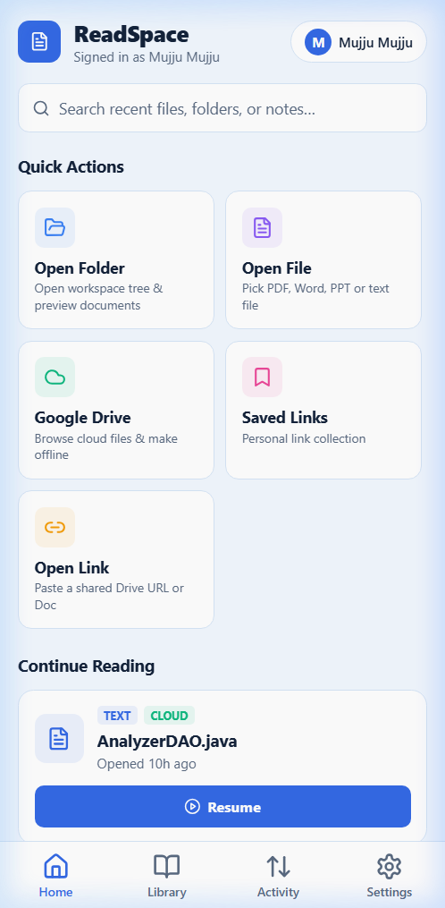
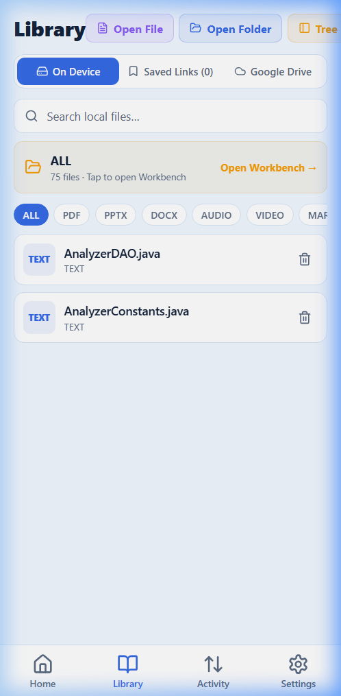
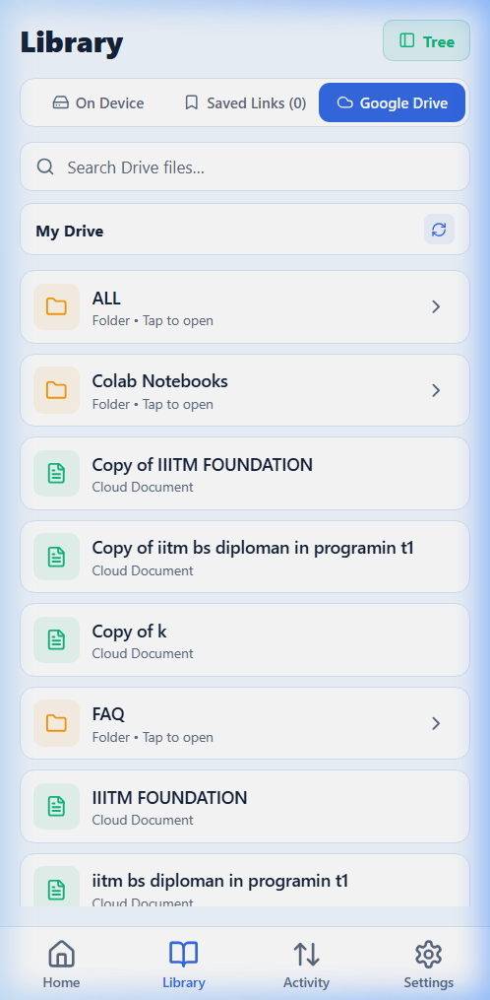
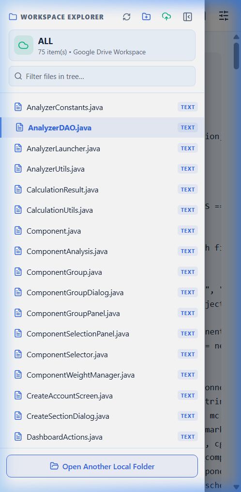
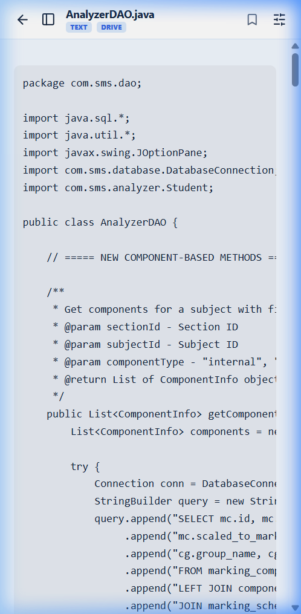
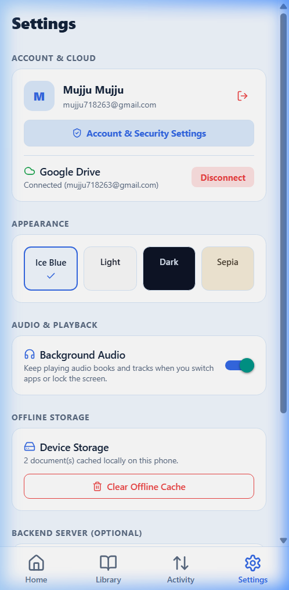

# ReadSpace Mobile 📱✨

<div align="center">


<br/>

**A distraction-free, offline-first mobile workspace & document reader built with React Native and Expo SDK 52. Unifies on-device storage with Google Drive cloud workspaces into a single reading workbench.**

[Features](#-key-features) • [UI Showcase](#-ui-showcase) • [Architecture](#-architecture--tech-stack) • [Getting Started](#-getting-started) • [Building APK](#-building-standalone-android-apk)

</div>

---

## 📸 UI Showcase

<table>
  <tr>
    <td width="33%" align="center">
      <b>🏠 Home Dashboard</b><br/><br/>
      
      <br/><sub>Quick Actions, Search, & Continue Reading resume card</sub>
    </td>
    <td width="33%" align="center">
      <b>📚 Library (Local Device)</b><br/><br/>
      
      <br/><sub>Local workspaces, document cards & format filters</sub>
    </td>
    <td width="33%" align="center">
      <b>☁️ Library (Google Drive)</b><br/><br/>
      
      <br/><sub>Cloud folder hierarchy with 0ms cache & Tree viewer</sub>
    </td>
  </tr>
  <tr>
    <td width="33%" align="center">
      <b>🗂️ Reader with Tree Sidebar</b><br/><br/>
      
      <br/><sub>Unified workspace tree for local & Drive folders</sub>
    </td>
    <td width="33%" align="center">
      <b>📖 Reader (Distraction-Free)</b><br/><br/>
      
      <br/><sub>Full-screen reading with mode & font toggles</sub>
    </td>
    <td width="33%" align="center">
      <b>⚙️ App Settings & Theme</b><br/><br/>
      
      <br/><sub>Ice Blue, Dark, Sepia themes & storage stats</sub>
    </td>
  </tr>
</table>

---

## 🌟 Key Features

### 1. 🗂️ Unified Workspace Sidebar Tree
- **Local & Google Drive Parity**: Browse Google Drive folders using the exact same hierarchical tree view as local folders.
- **Dynamic Lazy Loading**: Expand nested subfolders on demand with instant server-side TTL caching.
- **Instant File Switching**: Tap any document directly in the sidebar tree to fetch, render, and switch files without leaving the reader workbench.
- **Kind Badges & Visual Status**: Color-coded badges for `PDF`, `DOCX`, `PPTX`, `TEXT`, `CODE`, `AUDIO`, and `VIDEO`.

### 2. 📖 Universal Multi-Format Document Reader
- **PDF Documents**: High-resolution continuous page scrolling, canvas rendering, zoom controls, and page jumps.
- **Office Documents (DOCX & PPTX)**: Native-rendered Word documents and slide presentations.
- **Code & Markdown**: Syntax highlighting, code block copy, and GitHub-Flavored Markdown preview.
- **Audio & Video Media**: Background audio player with lock-screen support and video player with playback scrubbers.
- **Distraction-Free Mode**: Collapse the sidebar to immerse yourself into full-screen reading.

### 3. ☁️ Google Drive & Cloud Synchronization
- **One-Tap Authorization**: Connect personal or institutional Google accounts via secure OAuth 2.0 with PKCE.
- **1000-Item Batching**: Optimized directory listing fetching full folders in a single round-trip.
- **0ms Client Navigation Cache**: Instant back/forward directory navigation.
- **Saved Links**: Bookmark shared Google Drive links without duplicating files on the server.

### 4. 💾 True Offline-First Architecture
- **Dual-Layer Persistence**: `@react-native-async-storage/async-storage` for document metadata and IndexedDB/FileSystem for base64 file payloads.
- **Continue Reading**: Auto-saves page offsets, scroll coordinates, and last-opened timestamps.
- **Zero Server Dependency for Local Files**: Pick and read any file on your phone even in airplane mode.

### 5. 🎨 Ice Blue Aesthetics & Theming
- Built-in curated themes: **Ice Blue** (Signature), **Light**, **Dark**, and **Sepia**.
- Responsive layout adapting seamlessly across smartphones, foldables, tablets, and mobile web.

---

## 🏗️ Architecture & Tech Stack

```
readspace_app/
├── assets/                 # App icons, splash screens, and adaptive assets
├── public/                 # PWA web manifest and touch icons
├── screenshots/            # App store & documentation showcase screenshots
├── src/
│   ├── components/         # Reusable UI components & modals
│   │   ├── AccountMenuModal.tsx       # Profile menu & account settings
│   │   ├── AccountSecurityModal.tsx   # Passkey authentication & security
│   │   ├── AuthModal.tsx              # Google sign-in dialog
│   │   ├── CloudTransferModal.tsx     # Local-to-Drive transfer review
│   │   ├── FolderExplorerModal.tsx    # Unified workspace tree explorer
│   │   ├── HybridReader.tsx           # Native document viewing engine
│   │   ├── HybridReader.web.tsx       # Web-optimized reading viewport
│   │   ├── OpenDriveLinkModal.tsx     # Drive link parser modal
│   │   └── SavedLinksModal.tsx        # Cloud resource bookmarks
│   ├── navigation/
│   │   └── RootNavigator.tsx          # Bottom tabs + Native stack navigator
│   ├── screens/
│   │   ├── HomeScreen.tsx             # Dashboard, quick actions & recents
│   │   ├── LibraryScreen.tsx          # Local & Drive storage tabs
│   │   ├── ReaderScreen.tsx           # Document reader workbench
│   │   ├── ActivityScreen.tsx         # Offline sync queue & audit logs
│   │   └── SettingsScreen.tsx         # Theme switcher & storage manager
│   ├── services/
│   │   ├── api.ts                     # HTTP client for backend endpoints
│   │   ├── folder.ts                  # Workspace tree generator & opener
│   │   ├── gdrive.ts                  # Drive file parser & downloader
│   │   ├── picker.ts                  # Expo document picker wrapper
│   │   ├── storage.ts                 # AsyncStorage document & workspace cache
│   │   └── webIdb.ts                  # IndexedDB browser binary storage
│   ├── theme/
│   │   └── colors.ts                  # Ice Blue, Light, Dark, Sepia palette tokens
│   └── types.ts                       # TypeScript interfaces & data contracts
├── app.json                # Expo application configuration
├── babel.config.js         # Babel presets & plugins
├── metro.config.js         # Metro bundler config
└── package.json            # Dependencies & scripts
```

---

## 🚀 Getting Started

### Prerequisites
- Node.js (v18 or higher)
- npm or yarn
- Android phone with **Expo Go** (available on Google Play Store) or an Android Emulator

### 1. Installation
Clone the repository and install dependencies:

```bash
git clone https://github.com/mujju-212/readspaceapp.git
cd readspaceapp
npm install
```

### 2. Run with Expo
Start the Metro bundler:

```bash
# Start development server
npx expo start

# Or specifically targeting platforms:
npx expo start --android    # Open on connected Android device/emulator
npx expo start --web        # Open in mobile web browser (http://localhost:8081)
```

### 3. Open on Your Android Phone
1. Open the **Expo Go** app on your Android device.
2. Ensure your phone and development machine are connected to the same Wi-Fi network.
3. Scan the QR code displayed in your terminal.
4. The application will bundle and open natively!

---

## ⚙️ Backend & Google Drive Connection

While ReadSpace Mobile works 100% offline for local device files, connecting to the backend unlocks Google Drive synchronization:

1. **Start the backend server** (from the parent `readspace` repository):
   ```bash
   node server/index.mjs
   ```
2. In the mobile app, navigate to **Settings** → **Backend Server URL**.
3. Set your local computer's IP address (e.g. `http://192.168.1.100:5173` or your production domain).
4. Tap **Test Connection** to verify server status.
5. In **Library** → **Google Drive**, tap **Connect Drive** to authenticate.

---

## 📦 Building Standalone Android APK

To build a distributable `.apk` file that installs directly on any Android device without Expo Go:

```bash
# 1. Install EAS CLI globally
npm install -g eas-cli

# 2. Authenticate with your Expo account
eas login

# 3. Configure the build profile
eas build:configure

# 4. Trigger the preview APK build
eas build -p android --profile preview
```

EAS will generate a direct download link for the signed APK.

---

## 📄 License

Distributed under the MIT License. See `LICENSE` for more information.

---

<div align="center">
  <sub>Built with ❤️ using React Native, Expo, and TypeScript. Part of the ReadSpace ecosystem.</sub>
</div>
